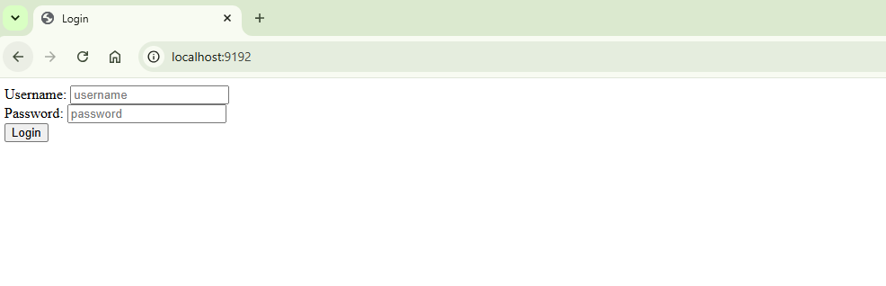
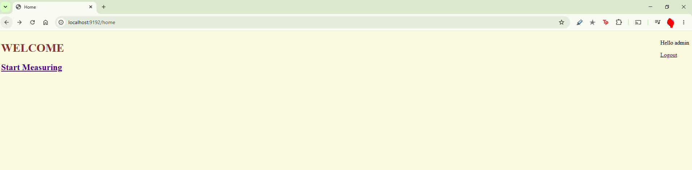
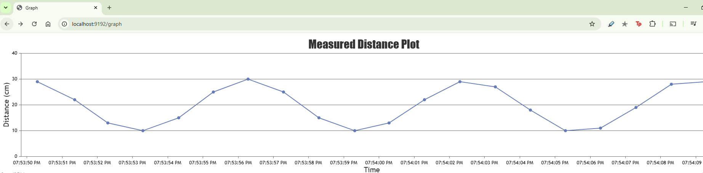

# PiPlot

**Raspberry Pi ultrasonic distance monitoring and live web visualization**

PiPlot is a personal Java project for measuring distance with an ultrasonic sensor connected to a Raspberry Pi and plotting the measurements in a web browser. It combines Pi4J GPIO access, a Spring Boot/Spring MVC backend, JSP views, and a JavaScript time-series chart.

The application also includes a **Windows simulation mode**. This generates sample distance readings so the existing login, Home page, measurement endpoint, and live graph can be demonstrated **without Raspberry Pi hardware**.

> **Status:** Working local demonstration in Windows simulation mode; original Raspberry Pi hardware mode needs further validation and reliability work. PiPlot uses legacy framework dependencies and is **not intended for public internet deployment** in its current form.

## Contents

- [Features and current status](#features-and-current-status)
- [Screenshots](#screenshots)
- [Technology stack](#technology-stack)
- [How it works](#how-it-works)
- [Getting started on Windows](#getting-started-on-windows)
- [Demonstration login](#demonstration-login)
- [Routes and measurement API](#routes-and-measurement-api)
- [Raspberry Pi hardware mode](#raspberry-pi-hardware-mode)
- [Repository structure](#repository-structure)
- [Known limitations](#known-limitations)
- [Development roadmap](#development-roadmap)
- [Background and license](#background-and-license)

## Features and current status

| Feature | Status | Notes |
| --- | --- | --- |
| Single-account demonstration login | **Implemented** | Educational example; not secure authentication |
| Home page and graph navigation | **Implemented** | JSP-based pages |
| Live distance-versus-time chart | **Demonstrated** | Tested using simulated readings in a browser |
| JSON measurement endpoint (`GET /run`) | **Demonstrated** | Returns a nested numeric measurement array |
| Windows simulation mode | **Demonstrated** | Produces changing readings without GPIO hardware |
| Ultrasonic-sensor GPIO acquisition | **Implemented, not recently hardware-validated** | Requires a compatible Raspberry Pi and safe wiring |
| Automated test suite | **Implemented** | 13 software-only JUnit/Spring MVC tests for simulation, provider selection, and API behavior |
| Modern dependenes and production security | **Planned** | See [ROADMAP.md](ROADMAP.md) |

The local Windows demonstration was run using **Eclipse Temurin JDK 8** and **Apache Maven 3.9.16**. The application started with `mvn spring-boot:run`; the demo login, Home page, graph, and `/run` response were observed in the browser. These results do **not** establish that physical sensor acquisition works on current Raspberry Pi hardware.

## Screenshots

These are screenshots of the running application, not UI mockups.

### Login page



### Home page



### Live graph using simulated measurements



The plotted data above is **simulated**. It is not a recording of a physical ultrasonic sensor.

## Technology stack

| Area | Current implementation |
| --- | --- |
| Language | Java 8-compatible source |
| Application framework | Spring Boot `1.5.6.RELEASE`, Spring MVC |
| Build | Apache Maven |
| Raspberry Pi integration | Pi4J `1.2` |
| Views | JSP, HTML, JavaScript |
| Charting | CanvasJS |
| Browser scripting | jQuery |
| API payload | JSON |
| Current verified development environment | Windows, Eclipse Temurin JDK 8, Maven 3.9.16 |

These are **existing implementation choices**, not recommended versions for new production systems. In particular, the Spring Boot and frontend dependenes are old and should be reviewed and modernized. CanvasJS and other third-party libraries remain subject to their own licenses.

## How it works

PiPlot supports two measurement paths feeding the same web interface.

```text
                           Browser
                  / (login) -> /home -> /graph
                                         |
                                GET /run (polling)
                                         |
                                 DistanceController
                                     /       \
                                    /         \
                     Simulation enabled       Simulation disabled
                     (Windows / no GPIO)      (Raspberry Pi hardware)
                             |                        |
                  Generated sample value     Pi4J GPIO trigger + echo
                             |                        |
                             +-----------+------------+
                                         |
                                JSON measuredData
                                         |
                              Distance-versus-time chart
```

- **Simulation:** `SimulationDistanceProvider` generates readings around 20 cm, varying approximately from 10 to 30 cm, rounded to two demal places. Its clock can be injected for deterministic tests. Selecting simulation does not initialize Raspberry Pi GPIO.
- **Hardware mode:** `HardwareDistanceProvider` contains the existing ultrasonic trigger/echo acquisition logic. Physical timing, timeout handling, and GPIO lifecycle still need improvement and hardware validation.
- **Frontend:** the graph requests `GET /run` periodically (currently about once per second), reads the returned measurement, and plots a window of recent points against time.

## Getting started on Windows

This is the **recommended demonstration path**, because it does not require Raspberry Pi hardware.

### Prerequisites

- Windows PC
- **Java JDK 8** (the tested environment used Eclipse Temurin 8)
- **Apache Maven 3.9.16** (the tested version; another compatible Maven 3.9.x release may also work)
- Git and a modern web browser
- Internet access to resolve Maven dependenes and the browser-hosted chart scripts on first use

Verify that Java and Maven are available in your terminal:

```bash
java -version
javac -version
mvn -version
```

The `mvn -version` output should show that Maven is running with the intended JDK 8 installation.

### 1. Get the source

```bash
git clone https://github.com/ccm026/PiPlot.git
cd PiPlot
```

### 2. Enable simulation

In `src/main/resources/application.properties`, use:

```properties
server.port=9192
piplot.simulation=true
```

- `true` uses generated distance measurements and avoids Raspberry Pi native GPIO access.
- `false` requests measurements through physical GPIO and is **not suitable for a normal Windows PC**.

For a strictly local-only demonstration, you can additionally set `server.address=127.0.0.1` to bind Spring Boot to the loopback interface. **This extra property is a recommendation, not a claim that the repository already contains it.**

### 3. Build

From the repository root (where `pom.xml` is located), run:

```bash
mvn -U clean verify
```

`-U` rechecks dependency metadata if Maven previously cached an unresolved version. The project previously used an unavailable `pi4j-core:1.2-SNAPSHOT` dependency; it has been changed to the published **Pi4J `1.2`** release.

> **Testing:** The project has 13 software-only JUnit/Spring MVC tests covering known simulation values, provider selection, `/run` success JSON, error responses, and JSP view mapping. The GitHub Actions Java 8 workflow is configured to run `mvn clean verify`; check the Actions tab for its actual status.

### 4. Start the application

```bash
mvn spring-boot:run
```

When the server starts, open:

**http://localhost:9192/**

Keep the terminal running while using the web application. Stop it with `Ctrl+C`.

### 5. Try the demonstration

1. Enter the demo credentials from the next section.
2. After login, select **Start Measuring** on the Home page.
3. The graph should display changing simulated readings.
4. Open **http://localhost:9192/run** in a separate browser tab to inspect a raw measurement response.

If the application does not start, first check that port `9192` is free, Java 8 is selected, the Pi4J dependency is version `1.2`, and `piplot.simulation=true` is set.

## Demonstration login

I added the login page during my student years as a **personal trial feature** to understand Spring MVC form submission, credential comparison, redirects, and page navigation. It was deliberately limited to **one predefined account** and remains part of the original application.

| Field | Demonstration value |
| --- | --- |
| Username | `admin` |
| Password | `password` |
| Login URL | `http://localhost:9192/` |
| Number of accounts | One |

After a successful form submission, the application redirects to `/home`. Invalid values display an error on the login page. The **Logout** link returns the browser to the login view.

**This is not a secure login system.** The credentials are hardcoded in `User.java`, there is no authenticated session or route authorization, and the logout link does not invalidate a session. `/home`, `/graph`, and `/run` are not protected behind a real login. These credentials are intentionally public for a local demonstration only. Do not reuse them for any real account or expose the application to untrusted networks.

A future version could support multiple accounts through proper password hashing, an identity store, session handling, authorization, and a genuine logout flow. Those capabilities **are not currently implemented**.

## Routes and measurement API

| Method | URL | Purpose |
| --- | --- | --- |
| `GET` | `/` | Show the demo login form |
| `POST` | `/` | Check the single demo account |
| `GET` | `/home` | Show Home page |
| `GET` | `/graph` | Show the measurement plot |
| `GET` | `/run` | Return the next distance value as JSON |
| `GET` | `/logout` | Show login page (not session invalidation) |

**Example** JSON response from simulation mode:

```json
{
  "measuredData": [[24.02]]
}
```

The array is nested: `measuredData` contains an array whose first element contains one numeric reading in centimeters. This format is retained for compatibility with the existing graph. For an unavailable, negative, or non-finite reading, `/run` returns HTTP `503` and `{"error":"measurement_unavailable"}`. The legacy JSP graph may need improved handling of that error response. The most recent Git commit also addresses integer parsing in the graph; further validation of fractional readings and malformed responses is planned.

The `/run` endpoint can be called independently of the login page because the login is only a demonstration.

## Raspberry Pi hardware mode

The Java controller uses Pi4J logical identifiers:

| Signal | Pi4J identifier |
| --- | --- |
| Trigger output | `RaspiPin.GPIO_00` |
| Echo input | `RaspiPin.GPIO_02` |

These identifiers are **not physical header pin numbers**. Consult the pin mapping for the exact Pi4J version, board, and operating system before wiring a sensor.

**Electrical safety:** Raspberry Pi GPIO inputs are not 5 V tolerant. Some ultrasonic sensors output a 5 V echo signal; use appropriate level shifting or a voltage divider where required. Never connect a 5 V echo pin directly to a 3.3 V GPIO input.

Hardware access can be selected with:

```properties
piplot.simulation=false
```

However, the legacy hardware implementation still has known issues, including unbounded echo polling, GPIO reinitialization/shutdown, and incorrect microsecond trigger timing. **Hardware-mode reliability has not been revalidated** and this configuration should not be treated as deployment-ready.

## Repository structure

```text
PiPlot/
├── .github/workflows/java-.yml
├── .gitignore
├── LICENSE
├── README.md
├── ROADMAP.md
├── pom.xml
├── screenshots/
│   ├── login.PNG
│   ├── home.PNG
│   └── simulation-graph.PNG
└── src/
    ├── main/
    │   ├── java/com/piproject/main/
    │   │   ├── Application.java
    │   │   ├── Controller/{DistanceController,LoginController,User}.java
    │   │   ├── measurement/{DistanceProvider,DistanceProviderConfiguration,
    │   │   │   HardwareDistanceProvider,SimulationDistanceProvider,
    │   │   │   MeasurementUnavailableException}.java
    │   │   └── webinit/{RootConfig,Webconfig,Webinit}.java
    │   ├── resources/application.properties
    │   └── webapp/WEB-INF/{login,home,graph}.jsp
    └── test/java/com/piproject/main/
        ├── Controller/DistanceControllerTest.java
        └── measurement/{DistanceProviderConfigurationTest,
            SimulationDistanceProviderTest}.java
```

The Maven-generated `target/` directory and IDE-spefic files are excluded using `.gitignore`.

## Known limitations

- **Legacy dependenes:** Spring Boot 1.5.6 and several manually pinned Spring/Tomcat/JavaScript dependenes are outdated. They need a compatibility and security review.
- **GPIO reliability:** the hardware path currently provisions and shuts down GPIO resources on each measurement; waiting for echo transitions has no timeout, and the current trigger delay is not a correct microsecond pulse.
- **Blocking hardware measurement:** the physical sensor path sleeps and polls synchronously; request performance and concurrent access are not yet robust.
- **Web UI:** the pages use older frontend libraries, duplicate jQuery references, and some HTTP-based script sources; error handling, dependency loading, and chart licensing deserve review.
- **Demonstration login:** the single account is not session-based authentication and does not protect routes.
- **API contract:** measurement JSON uses a nested array instead of a named measurement object; a future version could expose timestamp, unit, source, and error information.
- **Automated checks:** 13 software-only regression tests are included. Java 8 CI is configured; Hardware-dependent tests remain future work.
- **Platform coverage:** Windows simulation has been demonstrated; current Raspberry Pi hardware operation has not been verified.

## Development roadmap

A detailed work plan with scope, acceptance criteria, and estimated remaining development time is in **[ROADMAP.md](ROADMAP.md)**.

The roadmap does not count completed work, including the Java environment, stable Pi4J dependency, Windows simulation, integer parsing, extraction of the measurement providers, or the initial 13 regression tests. Remaining tasks focus on hardware reliability, frontend resilience, expanded regression coverage, dependency modernization, and documentation.

## Background and license

PiPlot began as a **personal project during my student years**. I used it to explore Raspberry Pi GPIO measurements, Java web development, form handling, and live data visualization. I have retained the original code and commit history and am continuing to improve the project independently.

This repository is available under the **[MIT License](LICENSE)**. That license applies to code and materials I have the right to license; third-party dependencies and services retain their respective license terms.

Feedback and reproducible bug reports are welcome through GitHub Issues. Please do not post private credentials, API keys, or sensitive data.
